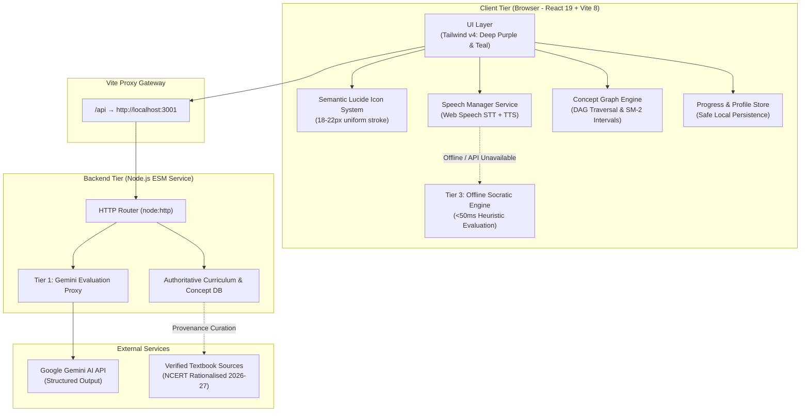
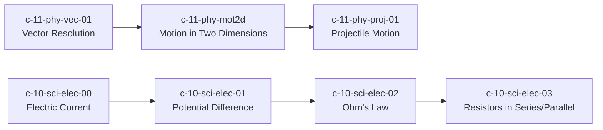

# GyaanConnect — System Architecture & Technical Design

**Document Version:** 2.0.0  
**Date:** October 15, 2026  
**Audience:** Full-Stack Engineers, Systems Architects, EdTech Specialists

---

## 1. Architectural Philosophy

GyaanConnect is built around the **Feynman Active Oral Recall loop**:
$$\text{Study Concept} \longrightarrow \text{Close Notes} \longrightarrow \text{Explain in Own Words} \longrightarrow \text{Diagnostic Feedback} \longrightarrow \text{Spaced Mastery}$$

The architecture separates five core domains:
1. **Presentation & Design System:** A clean, minimal educational SaaS UI designed with accessible typography, strict 4px/8px spacing, and outline Lucide icons.
2. **Voice & Auditory Pipeline:** Native browser speech services (STT & TTS) with zero-latency audio synthesis and graceful quiet-mode fallbacks.
3. **Pedagogical Knowledge Graph:** Directed Acyclic Graph (DAG) for prerequisite tracking and SuperMemo SM-2 spaced repetition scheduling.
4. **AI & Evaluation Service:** A secure server proxy evaluating concept mastery against authoritative rubrics, with a built-in offline heuristic evaluator.
5. **Curriculum Engine:** Strictly versioned, official board curriculum schema with source provenance and transparent curation status.

---

## 2. System Topology & Tiered Architecture



---

## 3. UI/UX Design System Specification

### 3.1 Color Palette
GyaanConnect replaces dark cyberpunk glassmorphism with a **clean, student-friendly, modern educational SaaS palette**:

| Token Name | Hex Code | Semantic Role |
| :--- | :--- | :--- |
| **`primary`** | `#56358B` | Deep Purple: Primary brand actions, active navigation, key buttons. |
| **`primary-hover`** | `#462973` | Darker Deep Purple for hover/focus states. |
| **`secondary`** | `#16A39A` | Teal: Voice learning indicators, progress bars, active mastery badges. |
| **`secondary-hover`** | `#138981` | Darker Teal for interactive feedback elements. |
| **`bg-canvas`** | `#FAF9FC` | Soft Off-White: Calming, distraction-free student background. |
| **`bg-surface`** | `#FFFFFF` | Pure White: Clean card backgrounds and content panels. |
| **`text-main`** | `#25212B` | Dark Charcoal: Maximum readable contrast for lesson reading (WCAG AAA). |
| **`text-muted`** | `#777381` | Muted Grey: Supporting metadata, timestamps, chapter numbers. |
| **`border-subtle`** | `#E9E5EF` | Light Grey-Lavender: Restrained borders for clean card grouping. |
| **`success`** | `#15803D` | Emerald Green: Conceptual mastery ($\ge 85\%$) and correct answers. |
| **`warning`** | `#B45309` | Amber: Misconception alerts and needs-review reminders. |

### 3.2 Iconography Rules
- **Library:** Exclusively `lucide-react`. No emojis as UI icons; no mixed icon sets.
- **Sizing Hierarchy:**
  - `16px`: Compact secondary actions, badge icons, metadata items.
  - `18–20px`: Standard controls, form inputs, navigation items.
  - `24–26px`: Major CTAs (Microphone recording button, Start Feynman Studio).
- **Stroke Width:** Uniform `2px` stroke weight across the entire application.
- **Alignment:** Flexbox centering with `gap-2` to strictly align icon baseline with adjacent label text.

### 3.3 Typography & Spacing Grid
- **Font Family:** Inter, system-ui, -apple-system, sans-serif.
- **Type Scale:**
  - Page Titles: `28–32px` (font-extrabold, tracking-tight).
  - Section Headings: `20–24px` (font-bold).
  - Card Headings: `16–18px` (font-semibold).
  - Body Text: `14–16px` (leading-relaxed, line-height: 1.6).
  - Helper & Metadata: `12–13px` (font-medium).
- **Spacing Grid:** Strict multiples of `4px` / `8px` (`p-4`, `p-6`, `space-y-4`, `gap-3`).

---

## 4. The 3-Tier AI Evaluation Pipeline

```mermaid
sequenceDiagram
    autonumber
    actor Student
    participant Browser as Client UI & SpeechManager
    participant Proxy as Server Proxy (/api/evaluate)
    participant DB as Authoritative Concept Database
    participant AI as Google Gemini 2.0 Flash
    participant Offline as Tier 3 Local Heuristic

    Student->>Browser: Verbalizes explanation of Concept
    Browser->>Proxy: POST /api/evaluate { conceptId: "c-10-sci-elec-02", studentAnswer: "..." }
    
    alt Server & Gemini Available
        Proxy->>DB: getConceptById("c-10-sci-elec-02")
        DB-->>Proxy: Returns trusted { mustKnowPoints, commonMisconceptions }
        Proxy->>AI: Prompts Gemini with TRUSTED rubric + student answer
        AI-->>Proxy: Returns structured JSON evaluation
        Proxy-->>Browser: HTTP 200 { understandingScore, mustKnowCovered, misconceptions, socraticFollowUp }
    else Server Offline or No Key Configured
        Proxy-->>Browser: HTTP 503 { fallbackToLocal: true }
        Browser->>Offline: evaluateLocally(studentAnswer, localConcept)
        Offline-->>Browser: Instant (&lt;50ms) structured heuristic response
    end

    Browser-->>Student: Displays 5-pillar scores, spoken tutor praise, and Socratic challenge
```

### Critical Security Invariant
**The browser is never permitted to supply its own grading rubric.** The server extracts `mustKnowPoints` exclusively from server-side memory using the validated `conceptId`. If `conceptId` is unrecognized, the server responds with `HTTP 404 Concept Not Found`.

---

## 5. Directed Acyclic Graph (DAG) Prerequisite Engine

Concepts are modeled as nodes in a DAG with directed dependency edges:
$$\text{Prerequisite Concept } (A) \longrightarrow \text{Dependent Concept } (B)$$



### Diagnostic Root-Cause Algorithm:
1. When a student attempts concept $C$ and scores $<65\%$ across attempts:
2. The engine calls `conceptGraphEngine.diagnoseRootCause(C.id, studentProgress)`.
3. It traverses upstream prerequisites.
4. If any prerequisite has mastery $<60\%$ or is unattempted, the system isolates the root cause and renders an intuitive banner:
   > *“Struggling with Projectile Motion? GYAAN diagnosed that your foundational gap is in Vector Resolution. Let's master that first!”*

---

## 6. Spaced Repetition (SuperMemo SM-2) Engine

GyaanConnect schedules future oral reviews using the SuperMemo SM-2 interval algorithm:
- **Score $\ge 85\%$ (Mastered):** Interval multiplier $I = 3\text{ to }7\text{ days}$.
- **Score $65–84\%$ (Developing):** Interval multiplier $I = 2\text{ to }3\text{ days}$.
- **Score $< 65\%$ (Needs Revision):** Review scheduled for tomorrow ($I = 1\text{ day}$).
- Overdue reviews are aggregated into a **Spaced Revision Queue** on the student dashboard.

---

## 7. Curriculum & Provenance Engine

$$\text{Board} \longrightarrow \text{Academic Year} \longrightarrow \text{Class} \longrightarrow \text{Subject} \longrightarrow \text{Chapter} \longrightarrow \text{Concept} \longrightarrow \text{Learning Objective}$$

- **Single Shared Source of Truth:** A unified registry defines all Indian boards (CBSE, ICSE, UP Board, State Boards).
- **Zero Mock Masquerading:** Unverified syllabus topics are labeled `status: 'curation_pending'` or `status: 'draft'`, recording the official textbook citation (e.g. *NCERT Class 10 Science Rationalised 2026-27*). Fake procedural chapter loops are strictly forbidden.

---

## 8. Technology Stack Summary

| Layer | Technology | Version | Architectural Responsibility |
| :--- | :--- | :--- | :--- |
| **Frontend Framework** | React | `^19.2.8` | Declarative UI, state management, accessibility. |
| **Build & Dev Tool** | Vite | `^8.2.2` | Rapid HMR, asset compilation, production bundling. |
| **Styling** | Tailwind CSS | `^4.3.3` | Clean SaaS design system with CSS custom properties. |
| **Icons** | Lucide React | `^1.43.0` | Consistent 18–22px outline vector iconography. |
| **Celebrations** | Canvas Confetti | `^1.9.4` | Physics-based particle celebration on oral mastery. |
| **Audio Synthesizer**| Web Audio API | Native | Zero-latency clicks, success chords, and warning tones. |
| **Speech STT** | Web Speech API | Native | Speech-to-text supporting Indian English and Hindi. |
| **Speech TTS** | SpeechSynthesis API | Native | Spoken tutor guidance with voice speed/pitch modulation. |
| **Backend Server** | Node.js `node:http` | `v20.18+` | Lightweight ESM REST API & secure Gemini proxy. |
| **Test Runner** | Vitest | `^3.0.0` | High-speed unit, integration, and scoring test suite. |
