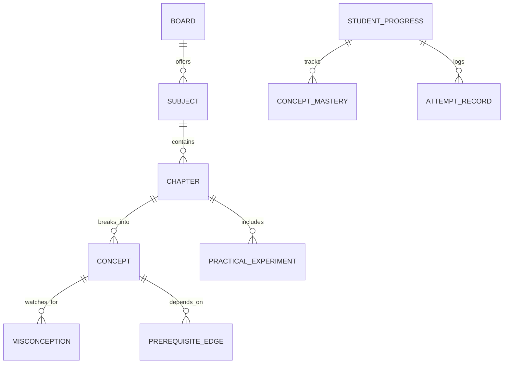

# GyaanConnect — Data Models & Schemas

**Document Version:** 2.0.0  
**Date:** October 15, 2026  
**Audience:** Full-Stack Developers, Database Engineers, Curriculum Specialists

---

## 1. Entity-Relationship Overview



---

## 2. Core Curriculum Data Schemas

### 2.1 Board Entity Schema
```typescript
interface Board {
  id: string;                      // e.g. "cbse" | "icse" | "up_board" | "maharashtra" | "bihar"
  name: string;                    // "CBSE (NCERT Rationalised)"
  shortName: string;               // "CBSE"
  tagline: string;                 // "Central Board of Secondary Education • 2026-27"
  primaryLanguage: 'en' | 'hi';    // Primary medium of instruction
  supportedLanguages: string[];    // ['en', 'hi', 'hinglish']
  phase: number;                   // 1 (Priority) to 4
  status: 'active' | 'curation_pending';
}
```

### 2.2 Subject Entity Schema
```typescript
interface Subject {
  id: string;                      // e.g. "sci-10", "math-10"
  name: string;                    // "Science" or "विज्ञान (Science)"
  icon: string;                    // Semantic Lucide icon key, e.g. "Atom", "Binary", "Flame"
  grade: number;                   // 1 to 12
  boardId: string;                 // "cbse", "up_board", etc.
  chapters: Chapter[];
}
```

### 2.3 Chapter Entity Schema (with Practicals & Real-World Context)
```typescript
interface Chapter {
  id: string;                      // e.g. "c10-sci-ch11"
  chapterNumber: number;           // 11
  title: string;                   // "Electricity" or "विद्युत (Electricity)"
  duration: string;                // "52 min"
  status: 'verified' | 'draft' | 'curation_pending';
  isCurated: boolean;
  difficulty: 'Foundation' | 'Board Standard' | 'Advanced';
  learningObjectives: string[];    // Target outcomes
  keyPoints: string[];             // Core summary takeaways
  oneShotVideo?: {
    id: string;                    // Verified YouTube ID
    title: string;
    duration: string;
  };
  topicVideos?: Array<{
    part: number;
    title: string;
    duration: string;
    id: string;
  }>;
  // Practical Lab & Real-World Enrichment (Master Specification Requirement)
  practicalActivity?: {
    title: string;                 // "Verification of Ohm's Law"
    objective: string;             // "Determine the resistance of a wire by plotting V vs I"
    apparatusRequired: string[];   // ["Ammeter", "Voltmeter", "Rheostat", "Nichrome wire", "Key", "Connecting wires"]
    safetyPrecautions: string[];   // ["Ensure zero error on meters", "Do not pass high current for prolonged time"]
    procedureSteps: string[];      // 1-2-3 step instructions
    realWorldExample: string;      // "How smartphone fast chargers modulate V & I using Ohm's Law"
    newsReference?: {
      headline: string;
      source: string;              // e.g. "ISRO Renewable Energy Initiative"
      url?: string;
    };
  };
  quiz?: Array<{
    q: string;
    options: string[];
    correct: number;
    explanation: string;
  }>;
}
```

### 2.4 Concept Entity Schema (DAG Node & Authoritative Rubric)
```typescript
interface ConceptNode {
  id: string;                      // Unique ID: "c-10-sci-elec-02"
  board: string;                   // "CBSE", "UP Board", etc.
  academicYear: string;            // "2026-27"
  class: number;                   // 10
  subject: string;                 // "Science"
  subjectId: string;               // "sci-10"
  chapterId: string;               // "c10-sci-ch11"
  chapterTitle: string;            // "Electricity"
  title: string;                   // "Ohm's Law & Resistance"
  description: string;             // Detailed conceptual summary
  learningObjectives: string[];
  prerequisites: string[];         // Parent concept IDs (e.g. ["c-10-sci-elec-01"])
  dependentConcepts: string[];     // Child concept IDs (e.g. ["c-10-sci-elec-03"])
  // Authoritative Server-Side Scoring Rubric
  mustKnowPoints: string[];        // Core criteria for AI evaluation
  commonMisconceptions: Array<{
    misconception: string;         // Trapped misconception
    correction: string;            // Physical/scientific truth
  }>;
  socraticQuestion: string;        // Follow-up intuition probe
  difficulty: 'easy' | 'medium' | 'hard';
  status: 'verified' | 'draft' | 'curation_pending';
  provenance: {
    source: string;                // e.g. "NCERT Science Class 10, Chapter 11, Section 11.2"
    verifiedBy?: string;
    updatedAt: string;
  };
}
```

---

## 3. Evaluation & AI Response Schema

The backend `/api/evaluate` endpoint always validates Gemini responses against this exact contract before sending it to the client:

```typescript
interface EvaluationResult {
  understandingScore: number;      // 0 to 100
  accuracyScore: number;           // 0 to 100
  clarityScore: number;            // 0 to 100
  confidenceScore: number;         // 0 to 100
  praise: string;                  // Warm encouraging phrase ("Shabash! 🌟 Brilliant effort...")
  gentleTip: string;               // Constructive tip for board exam rigor
  speakingTip: string;             // Encouragement for spoken fluency
  strengths: string[];             // What the student grasped well
  mustKnowCovered: string[];       // Must-know points verified in the answer
  mustKnowMissed: string[];        // Core points missed or incomplete
  misconceptionsDetected: Array<{
    detected: string;              // Specific error identified
    correction: string;            // Scientifically accurate reality
  }>;
  prerequisiteDiagnosed?: {        // Root-cause alert if struggling
    conceptId: string;
    title: string;
    reason: string;
  } | null;
  actionableGapFix: string;        // 1-2 sentence bite-sized explanation
  socraticFollowUp: string;        // Intuition question testing changed conditions
  tutorSpeech: string;             // Spoken script for speech synthesis
  masteryImpact: number;           // +10 to +25 score contribution
}
```

---

## 4. Student Learning Progress & Persistence Schema

Stored in browser `localStorage` under `gyan_student_progress_v2` (and synced to PostgreSQL in Phase 7):

```typescript
interface StudentProgressState {
  version: '2.0.0';
  lastActiveDate: string;          // YYYY-MM-DD
  concepts: {
    [conceptId: string]: {
      conceptId: string;
      conceptTitle: string;
      chapterId: string;
      subject: string;
      grade: number;
      boardId: string;
      mastery: number;             // 0 to 100
      understanding: number;
      explanation: number;
      quiz: number;
      confidence: number;
      status: 'not_started' | 'in_progress' | 'mastered' | 'needs_revision';
      attempts: number;
      lastScore: number;
      bestScore: number;
      lastStudied: string;         // ISO string
      nextRevisionDate: string;    // YYYY-MM-DD (SuperMemo SM-2)
      misconceptions: string[];    // Historic trapped errors
    };
  };
  quizHistory: Array<{
    chapterId: string;
    score: number;
    total: number;
    date: string;
  }>;
  gamification: {
    xp: number;
    level: number;
    streak: number;
    lastActiveDate: string;
    badges: string[];              // ['curious_scholar', 'feynman_master', ...]
  };
}
```
