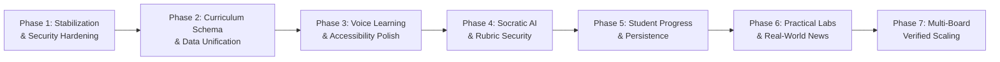

# GyaanConnect — Feature Roadmap & Phased Implementation Plan

**Document Version:** 1.0.0  
**Date:** October 15, 2026  
**Status:** Pending Student Developer & Architect Review

---

## 1. Roadmap Principles

To develop GyaanConnect reliably without breaking existing features or introducing technical debt, all work follows these core engineering rules:
- **Smallest Safe Increment:** Never embark on a massive rewrite; make modular, verifiable changes.
- **No Mock Masquerading:** Never fabricate official syllabus coverage or use dummy loops just to make a screen look populated.
- **Security & Integrity First:** Secure backend rubrics before scaling AI features.
- **Verification Gate:** Every phase must pass lint, build, unit tests, and browser verification before moving forward.

---

## 2. Phase Breakdown

### Phase 1: Immediate Stabilization & Security Hardening (Current Priority)
**Goal:** Fix failing lint scripts, patch critical prompt-injection vulnerabilities, implement missing backend routes, and install a testing framework.

- [ ] **1.1 Oxlint & Build Pipeline Fix:**
  - Update `.gitignore` and `.oxlintrc.json` to exclude `.vite_cache` and `dist`.
  - Fix cascading `setState` calls in `ConceptSelectionGrid.jsx` and `ProveUnderstandingStudio.jsx`.
  - Verify `npm run lint` passes with 0 errors and 0 warnings.
- [ ] **1.2 Dedicated Git Isolation:**
  - Initialize clean git repository directly in `c:\Users\krish\OneDrive\GYAAN` with proper `.gitignore` so personal OS folders are never tracked.
- [ ] **1.3 Backend Rubric Hardening (`POST /api/evaluate`):**
  - Refactor server evaluation to look up trusted concepts by `conceptId` from `curriculumDatabase.js`.
  - Reject client-supplied `mustKnowPoints` or grading rubrics.
- [ ] **1.4 Implement Missing Backend Endpoints:**
  - Add `GET /api/curriculum/subjects` in `server/index.js`.
  - Add `GET /api/curriculum/chapters` in `server/index.js`.
  - Ensure client service calls no longer produce silent 404s.
- [ ] **1.5 Clean Dead Code:**
  - Safely remove or archive `src/components/AiVoiceRoom.jsx`.
- [ ] **1.6 Install Vitest & Testing Scaffold:**
  - Install `vitest`, `@testing-library/react`, and jsdom.
  - Add `"test": "vitest run"` script to `package.json`.

---

### Phase 2: Curriculum System & Schema Unification
**Goal:** Consolidate the 3 conflicting board databases, eliminate fake procedural chapter loops, and establish official curriculum provenance.

- [ ] **2.1 Unified Curriculum Repository:**
  - Create a single source of truth for Boards, Classes, Subjects, and Chapters.
  - Harmonize board metadata across frontend and backend.
- [ ] **2.2 Transparent Coverage Labeling:**
  - Replace `generateChaptersForSubject` dummy loops (`Chapter 1: Unit 1`) with genuine NCERT Rationalised 2026-27 syllabus tables.
  - For topics not yet populated with video/lesson content, clearly mark them as `status: "curation_pending"` or `status: "draft"` rather than generating fake units.
- [ ] **2.3 Provenance Tracking:**
  - Attach source references (e.g. `NCERT Class 10 Science Chapter 12`, official circular number) to each concept record.

---

### Phase 3: Voice Learning & Studio Accessibility Polish
**Goal:** Perfect the voice interaction pipeline, ensure accessibility compliance, and enhance auditory feedback.

- [ ] **3.1 Accessibility (WCAG 2.1 AA):**
  - Implement accessible ARIA labels for microphone toggle, audio controls, and modal close buttons.
  - Ensure 100% keyboard navigability through the Feynman Studio (tab index, enter to record, esc to stop).
- [ ] **3.2 Recording State Indicators:**
  - Provide clear visual indicators for `listening`, `speech detected`, `silence`, `evaluating`, and `permission denied`.
- [ ] **3.3 Text-Answer Quiet Mode Fallback:**
  - Enhance text input mode for noisy classrooms, libraries, or devices without working microphones.
- [ ] **3.4 Audio Tutor Controls:**
  - Provide intuitive read-aloud playback controls (play, pause, stop, speed adjustment) for GYAAN AI's spoken responses.

---

### Phase 4: Socratic AI & Diagnostic Evaluation Engine
**Goal:** Expand conceptual depth evaluation, support multilingual nuance (Hinglish/Hindi), and prevent repetitive AI outputs.

- [ ] **4.1 5-Pillar Conceptual Depth Scoring:**
  - Evaluate Accuracy, Understanding, Clarity, Confidence, and Misconception Avoidance.
  - Return structured, age-appropriate positive reinforcement (*"Shabash!"*).
- [ ] **4.2 Multi-Turn Socratic Follow-Up:**
  - When a student demonstrates basic recall, probe deeper: *"What happens if we double the resistance in this circuit while keeping voltage constant?"*
- [ ] **4.3 Error Reporting & Feedback Correction:**
  - Provide a 1-click `Report Incorrect Evaluation` mechanism for students to challenge AI assessments.
- [ ] **4.4 API Outage & Rate Limit Resilience:**
  - Provide friendly user-facing messages during Google Gemini timeouts, and automatically fall back to the Tier 3 local diagnostic engine.

---

### Phase 5: Student Progress & Persistence Architecture
**Goal:** Transition from isolated localStorage to optional server synchronization, prevent progress fraud, and track authentic mastery.

- [ ] **5.1 Authentic Mastery Criteria:**
  - Never mark a chapter complete simply because it was opened.
  - Require demonstrated active recall ($\ge 80\%$ understanding score on core concepts) or completed practice assessments.
- [ ] **5.2 Server-Side Progress Sync (REST / Database):**
  - Introduce lightweight server persistence endpoint (`POST /api/progress`) for registered students.
  - Clearly display `Saved Locally` vs `Synced to Cloud` indicators.
- [ ] **5.3 Anti-Abuse Gamification Engine:**
  - Calculate daily learning streaks only when genuine learning activity occurred on consecutive calendar days.
  - Rate-limit XP gains to avoid spamming the microphone.

---

### Phase 6: Practical Activities, Real-World Examples & News
**Goal:** Deliver hands-on STEM learning and real-world connection as specified in the master design requirements.

- [ ] **6.1 Materials & Practical Lab Instructions:**
  - Add practical experiment instructions for CBSE/UP Board Science:
    - Example: *Ohm's Law Verification using voltmeter, ammeter, and rheostat.*
    - Materials required, safety instructions, step-by-step procedure, and common experimental errors.
- [ ] **6.2 Real-World Application Stories:**
  - Add practical real-world context for each concept (e.g., *How EV charging systems use Joule heating safeguards*).
- [ ] **6.3 Relevant Curated Science News Links:**
  - Provide curated, age-appropriate links connecting syllabus topics to contemporary scientific breakthroughs (ISRO missions, renewable energy advancements).

---

### Phase 7: Multi-Board Expansion & Verification
**Goal:** Systematically expand verified syllabus coverage across all target educational boards.

- [ ] **Phase 7.1:** CBSE (NCERT Rationalised 2026-27) Classes 9–12 Complete Science & Maths.
- [ ] **Phase 7.2:** UP Board (UPMSP) Bilingual Hindi/English Classes 9–12.
- [ ] **Phase 7.3:** ICSE / ISC (CISCE) Class 10 & 12 Science & Maths.
- [ ] **Phase 7.4:** State Boards (Maharashtra MSBSHSE, Bihar BSEB, Rajasthan RBSE, Karnataka KSEAB).
