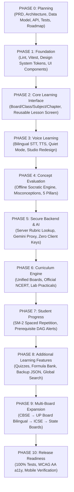

# GyaanConnect — Implementation Roadmap (Phases 0–10)

**Document Version:** 2.0.0  
**Date:** October 15, 2026  
**Execution Strategy:** Single-Milestone Incremental Delivery with Approval Gates

---

## 1. Roadmap Overview & Phased Milestones

---

## 2. Milestone Details & Acceptance Criteria

### PHASE 0: Planning (COMPLETED)
- [x] Extract traceable requirements from reference documents into [`docs/PRODUCT_REQUIREMENTS.md`](file:///c:/Users/krish/OneDrive/GYAAN/docs/PRODUCT_REQUIREMENTS.md).
- [x] Author technical architecture and design system specification in [`docs/ARCHITECTURE.md`](file:///c:/Users/krish/OneDrive/GYAAN/docs/ARCHITECTURE.md).
- [x] Specify data models, DAG edges, and progress schemas in [`docs/DATA_MODEL.md`](file:///c:/Users/krish/OneDrive/GYAAN/docs/DATA_MODEL.md).
- [x] Formulate REST API contracts and security rules in [`docs/API_SPEC.md`](file:///c:/Users/krish/OneDrive/GYAAN/docs/API_SPEC.md).
- [x] Define testing pyramid, rubric security tests, and a11y checks in [`docs/TEST_PLAN.md`](file:///c:/Users/krish/OneDrive/GYAAN/docs/TEST_PLAN.md).
- [x] Create implementation roadmap in [`docs/IMPLEMENTATION_ROADMAP.md`](file:///c:/Users/krish/OneDrive/GYAAN/docs/IMPLEMENTATION_ROADMAP.md).
- [x] Present plan for user review and approval before writing code.

---

### PHASE 1: Foundation (Next Milestone Upon Approval)
- [ ] **1.1 Linter & Git Exclusions:**
  - Add `.vite_cache` and `dist` to `.gitignore`.
  - Configure `.oxlintrc.json` ignore patterns so `npm run lint` scans only source code.
- [ ] **1.2 Automated Test Harness:**
  - Install `vitest` in `devDependencies`.
  - Add `"test": "vitest run"` script to `package.json`.
- [ ] **1.3 Premium Design System Tokens (Tailwind CSS v4):**
  - Configure CSS custom properties:
    - Primary Deep Purple (`#56358B`, hover `#462973`)
    - Secondary Teal (`#16A39A`, hover `#138981`)
    - Background Soft Off-White (`#FAF9FC`)
    - Surface Card White (`#FFFFFF`)
    - Text Charcoal (`#25212B`) and Muted Grey (`#777381`)
    - Borders Light Grey-Lavender (`#E9E5EF`)
- [ ] **1.4 Reusable UI Primitive Components:**
  - Create `src/components/ui/Button.jsx` (Primary, Secondary, Outline, Ghost variants).
  - Create `src/components/ui/IconButton.jsx` (Accessible labels, 16px/20px/24px sizing, tooltip).
  - Create `src/components/ui/StatusBadge.jsx` (Mastered, Developing, Needs Review, Curation Pending).
  - Create `src/components/ui/Card.jsx` (Clean white surface, subtle lavender border, comfortable padding).
- [ ] **1.5 Clean Up Dead Code:**
  - Remove orphaned `src/components/AiVoiceRoom.jsx`.
- [ ] **Acceptance Criteria:** `npm run lint`, `npm test`, and `npm run build` all pass with 0 errors.

---

### PHASE 2: Core Learning Interface
- [ ] **2.1 Header & Sidebar Navigation:**
  - Clean desktop navbar and compact mobile navigation bar using Deep Purple and Teal.
  - Dropdown selector for Board and Class (1–12).
- [ ] **2.2 Subject Catalog & Cards:**
  - Responsive cards with consistent 20px Lucide icons (Atom for Science, Binary for Math, etc.).
- [ ] **2.3 Chapter Listing with Verified Status:**
  - Distinct badges for `Verified Syllabus`, `Draft`, and `Curation Pending`.
  - Duration and completion indicators.
- [ ] **2.4 Reusable Lesson Screen:**
  - Learning objectives, key formulas, and practical experiment instructions.
- [ ] **Acceptance Criteria:** Fluid navigation across Boards, Classes, Subjects, and Chapters verified in browser.

---

### PHASE 3: Voice Learning & Studio Redesign
- [ ] **3.1 Feynman Oral Recall Studio Overhaul:**
  - Redesign using Deep Purple `#56358B` and Teal `#16A39A`.
  - Prominent, accessible microphone toggle button with subtle listening pulse.
  - 4-phase state transitions: Briefing &rarr; Explaining &rarr; Evaluating &rarr; Evaluated.
- [ ] **3.2 Speech Recognition (STT):**
  - Web Speech API integration supporting Indian English (`en-IN`) and Hindi (`hi-IN`).
  - Clear visual states: *Idle*, *Listening*, *Speech Detected*, *Processing*.
- [ ] **3.3 Speech Synthesis (TTS):**
  - Spoken tutor guidance with voice speed and pitch controls.
  - Intuitive "Stop Speaking" control and immediate cancellation on navigation.
- [ ] **3.4 Quiet-Room Fallback:**
  - Seamless toggle to text input mode with keyboard shortcut (`Enter` to submit).
- [ ] **Acceptance Criteria:** Speech input transcribed and spoken feedback read aloud with zero audio stored on disk.

---

### PHASE 4: Concept Evaluation & Offline Socratic Engine
- [ ] **4.1 Offline Heuristic Evaluation Engine:**
  - Deterministic evaluation based on must-know points coverage and common misconceptions.
  - Clamped 5-pillar scoring: Understanding, Accuracy, Clarity, Confidence, Misconception Penalty.
- [ ] **4.2 Multi-Turn Socratic Follow-Up:**
  - Probes student intuition on changed parameters (e.g. *"What happens if resistance is doubled?"*).
- [ ] **4.3 Error-Reporting CTA:**
  - Button allowing students to report disputed AI feedback.
- [ ] **Acceptance Criteria:** 100% test pass rate in `tests/scoring.test.js`.

---

### PHASE 5: Secure Backend & AI Integration
- [ ] **5.1 Authoritative Rubric Lookup:**
  - `POST /api/evaluate` extracts concept criteria by `conceptId` strictly from server memory.
  - Reject client-injected rubrics; return HTTP 400/404 for invalid IDs.
- [ ] **5.2 Server-Side Gemini API Proxy:**
  - Calls Gemini 2.0 Flash using backend `process.env.GEMINI_API_KEY`.
  - Validates structured JSON response against `EvaluationResult` schema.
  - Returns HTTP 503 `{ fallbackToLocal: true }` when key is absent or network fails.
- [ ] **5.3 Eliminate Client Keys:**
  - Remove all client-side `localStorage` key reading/writing.
- [ ] **Acceptance Criteria:** `tests/rubricSecurity.test.js` passes; server never trusts client rubrics.

---

### PHASE 6: Authoritative Curriculum Engine
- [ ] **6.1 Unified Board Schema:**
  - Single authoritative registry for CBSE, ICSE, UPMSP, and State Boards.
- [ ] **6.2 Official NCERT Syllabus Mapping:**
  - Authentic Class 10 Science & Math syllabus mapping with textbook citations.
  - Replace procedural dummy loops with authentic NCERT chapter lists labeled `status: 'curation_pending'`.
- [ ] **6.3 Practical Lab Instructions & Real-World Examples:**
  - Science practical experiments: apparatus list, safety precautions, procedure steps, and contemporary science news connections.
- [ ] **Acceptance Criteria:** `GET /api/curriculum/subjects` and `GET /api/curriculum/chapters` return authentic data without 404s.

---

### PHASE 7: Student Progress & Spaced Repetition
- [ ] **7.1 Spaced Repetition Scheduler:**
  - SuperMemo SM-2 interval algorithm scheduling reviews at 1d, 3d, 7d intervals.
- [ ] **7.2 Concept Graph Prerequisite Alerts:**
  - DAG traversal detects upstream gaps when downstream concepts score $<60\%$.
- [ ] **7.3 Authentic Completion Invariants:**
  - Mark concepts complete only after verified oral recall or passing quizzes.
- [ ] **Acceptance Criteria:** `tests/conceptGraphEngine.test.js` passes with 100% assertions.

---

### PHASE 8: Additional Learning Features
- [ ] **8.1 Practice Quiz Arena:** Conceptual MCQs with step-by-step explanations and anti-spam XP.
- [ ] **8.2 Lecture Theater & Formula Bank:** Reusable notes, formulas, and video marathon player.
- [ ] **8.3 Validated JSON Backup:** Export/import student records with schema verification.
- [ ] **8.4 Global Search (`Ctrl+K`):** Keyboard-driven search across concepts, chapters, and subjects.
- [ ] **Acceptance Criteria:** All extra features styled in Deep Purple & Teal design system.

---

### PHASE 9: Multi-Board Expansion
- [ ] **9.1 CBSE Rationalised 2026-27:** Complete Classes 9–12 Science and Math.
- [ ] **9.2 UP Board (UPMSP):** Bilingual Hindi/English curriculum for Classes 9–12.
- [ ] **9.3 ICSE / CISCE:** Class 10 & 12 Science and Math.
- [ ] **Acceptance Criteria:** Curriculum provenance verified against official board publications.

---

### PHASE 10: Release Readiness & Verification
- [ ] Complete test execution (`npm test`, `npm run lint`, `npm run build`).
- [ ] WCAG 2.1 AA accessibility audit (contrast, keyboard navigation, screen reader ARIA).
- [ ] Responsive testing across mobile (375px), tablet (768px), and desktop (1440px).
- [ ] Produce final release report.
