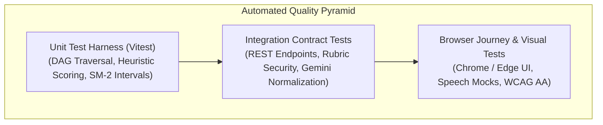

# GyaanConnect — Quality Assurance & Test Plan

**Document Version:** 2.0.0  
**Date:** October 15, 2026  
**Status:** Approved for Implementation

---

## 1. Quality Assurance Strategy & Test Pyramid

Our testing framework balances high-speed automated unit testing, API contract tests, accessibility audits, and browser regression testing:



---

## 2. Automated Test Matrix

### 2.1 Unit Tests (Vitest)

| Test Suite File | Module Under Test | Critical Test Assertions |
| :--- | :--- | :--- |
| **`tests/conceptGraphEngine.test.js`** | `src/services/conceptGraphEngine.js` | 1. **DAG Acyclic Guarantee:** Graph contains zero cyclic loops ($A \to B \to A$).<br/>2. **Prerequisite Health:** If prerequisite has mastery $<60\%$, returns `ready: false` with status `blocked` or `at_risk`.<br/>3. **Lineage Traversal:** Returns complete ancestral path ($A \to B \to C$).<br/>4. **SM-2 Intervals:** $\ge 85\% \to 3–7$ days; $65–84\% \to 2–3$ days; $<65\% \to 1$ day. |
| **`tests/scoring.test.js`** | `src/services/aiVoiceService.js` | 1. **Must-Know Matching:** Accurately matches partial spoken phrases against required physics/chemistry concepts.<br/>2. **Misconception Detection:** Subtracts points and flags specific mental traps.<br/>3. **Boundary Clamping:** All scores (accuracy, understanding, clarity, confidence) strictly clamped to $[0, 100]$.<br/>4. **Mastery Formula:** Weighted mastery equals $(Understanding \times 0.45) + (Explanation \times 0.55)$ when no quiz was taken. |
| **`tests/aiResponseValidation.test.js`** | `src/services/aiVoiceService.js` | 1. **Malformed JSON:** Safe fallback when Gemini returns partial or unparseable JSON.<br/>2. **Missing Fields:** Synthesizes age-appropriate default feedback if fields are absent.<br/>3. **String Numbers:** Safely coerces string numbers (`"85"`) to numeric types (`85`). |
| **`tests/speechManager.test.js`** | `src/services/aiVoiceService.js` | 1. **Permission Denied:** Returns friendly instruction to enable microphone or type.<br/>2. **No Speech Detected:** Returns gentle prompt encouraging another attempt.<br/>3. **TTS Cancellation:** Speech synthesis halts immediately when user navigates or stops. |

---

### 2.2 Security & Integration Tests

| Test Suite File | Module Under Test | Critical Security Assertions |
| :--- | :--- | :--- |
| **`tests/rubricSecurity.test.js`** | `server/index.js` (`handleEvaluate`) | 1. **Reject Missing Concept:** Calling `POST /api/evaluate` without `conceptId` returns HTTP 400.<br/>2. **Reject Unknown Concept:** Calling with non-existent `conceptId` returns HTTP 404.<br/>3. **Ignore Client-Injected Rubrics:** Submitting `{ conceptId: "...", mustKnowPoints: ["fake"] }` evaluates strictly against authoritative database rubrics and completely ignores the client's injected points. |
| **`tests/curriculumEndpoints.test.js`** | `server/index.js` (`curriculumRoutes`) | 1. **`GET /api/curriculum/boards`:** Returns unified array of all active boards.<br/>2. **`GET /api/curriculum/classes`:** Returns array `[1..12]`.<br/>3. **`GET /api/curriculum/subjects`:** Validates class integer (1–12); returns 400 on invalid input.<br/>4. **`GET /api/curriculum/chapters`:** Returns verified chapters or `curation_pending` metadata without 404s.<br/>5. **`GET /api/curriculum/concepts`:** Returns concept list filtered by chapter.<br/>6. **`GET /api/curriculum/concept/:id/graph`:** Returns DAG node, prerequisites, and dependents. |

---

### 2.3 UI/UX Design System & Accessibility (a11y) Verification

| Test Scope | Criteria & Acceptance Standard |
| :--- | :--- |
| **Color Tokens** | Verify primary elements use Deep Purple (`#56358B`), interactive highlights use Teal (`#16A39A`), canvas uses Soft Off-White (`#FAF9FC`), cards use White (`#FFFFFF`), and text uses Dark Charcoal (`#25212B`). |
| **Icon Consistency** | Verify 100% of icons originate from `lucide-react` with 18–22px standard sizing and 2px uniform stroke. Zero emojis used as UI icons. |
| **Keyboard Navigability** | Student can complete the full Feynman loop (`Select Concept` &rarr; `Start Speaking` &rarr; `Submit` &rarr; `Next`) using exclusively `Tab`, `Enter`, `Space`, and `Esc`. |
| **Screen Reader ARIA** | Active microphone recording states announce `Microphone listening`, `Speech detected`, `Evaluating answer` to screen readers. |
| **Responsive Layout** | Verify zero horizontal scroll on mobile ($375\text{px} - 414\text{px}$); fluid sidebar toggle on desktop ($\ge 1024\text{px}$). |
| **High Contrast & Zoom** | All text meets WCAG 2.1 AA contrast ($\ge 4.5:1$). Layout remains unbroken at 200% browser zoom. |

---

## 3. Test Execution Protocol

```bash
# 1. Run all automated unit & integration suites
npm test

# 2. Run tests in watch mode during development
npm run test:watch

# 3. Static linter verification
npm run lint

# 4. Production build validation
npm run build
```

**Quality Gate:** No code may be committed or merged unless `npm test`, `npm run lint`, and `npm run build` all pass with **0 errors and 0 warnings**.
